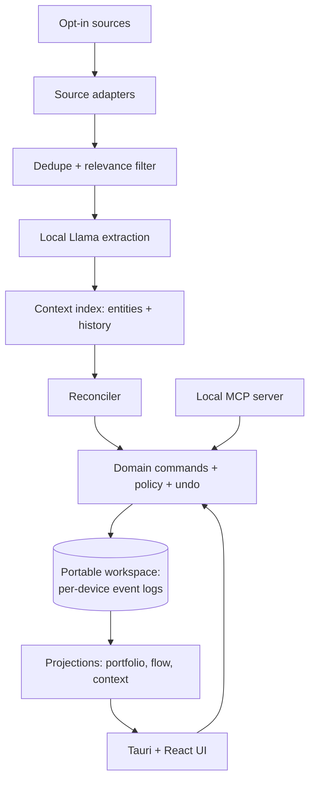

<p align="center"></p>

# Fulcrum

A local-first, single-user macOS app for keeping a portfolio of work initiatives clear. Fulcrum quietly gathers evidence from the conversations and files you opt into, uses an on-device Meta Llama model to keep each initiative's plan current, and lets you regain orientation in about 30 seconds after days away.

- **Initiatives are the top-level cards.** Each has exactly one flow graph of Tasks, Dependencies, Decisions and Milestones.
- **Tasks are only your own work.** Anything someone else (or something else) has to do is a Dependency.
- **No percent-complete bars, no Kanban status columns, no built-in AI chat.** Conversation happens in your own MCP client, through the same commands the UI uses.
- **Your data stays on your Mac.** The workspace is a folder of plain files you choose (optionally in Dropbox or Google Drive). Inference runs locally. No accounts, no telemetry, no hosted backend.

## Status

**Phase 0: architecture and contracts. There is no app yet.**

What exists: product spec, architecture, versioned JSON Schemas, a reference model of the merge and derived-state rules with tests, synthetic fixtures, ADRs, a risk register and an ordered backlog.

What has **not** been validated: any connector, any local model's speed or quality, Graphiti, behavior under Dropbox/Google Drive, Tauri packaging, or MCP with a real client. Everything marked *provisional* depends on the feasibility spikes at the top of the [backlog](backlog/BACKLOG.md).

## Architecture at a glance



One TypeScript core process per Mac owns all writes. The workspace is append-only event logs (one writer per file, so sync clients never have to merge), folded deterministically into state. Indexes, model files and credentials stay machine-local. Details: [docs/ARCHITECTURE.md](docs/ARCHITECTURE.md).

## Documentation

| Read | For |
|---|---|
| [Product spec](docs/PRODUCT_SPEC.md) | What Fulcrum is and must never become (authoritative) |
| [Design rules](docs/DESIGN_RULES.md) | Visual and interaction contract |
| [Architecture](docs/ARCHITECTURE.md) | Components, boundaries, data flow, module contracts |
| [Data model](docs/DATA_MODEL.md) · [schemas](schemas/v1) | Records, invariants, derived state |
| [Workspace format](docs/WORKSPACE_FORMAT.md) | Files, events, merge, migration, backup |
| [Domain commands](docs/DOMAIN_COMMANDS.md) | Command catalog, autonomy policy, undo |
| [Ingestion](docs/INGESTION.md) · [Operations](docs/OPERATIONS.md) | Pipeline, sleep/wake, resources, model tiers |
| [MCP](docs/MCP.md) · [Security model](docs/SECURITY_MODEL.md) | Tool contract, threat model, trust boundaries |
| [Onboarding](docs/ONBOARDING.md) | Install plan for non-technical Mac users |
| [Decisions](docs/decisions) · [Risks](docs/RISKS.md) | ADRs and the risk register |
| [Scenarios](docs/SCENARIOS.md) · [Backlog](backlog/BACKLOG.md) · [Progress](backlog/PROGRESS.md) | Golden tests, the work plan and where it stands |

## Development checks

Requires Node 22.13+ (22 LTS), 24 LTS, or 26+. pnpm is pinned in `package.json`.

```bash
corepack enable
pnpm install --frozen-lockfile
```

```bash
pnpm check
```

This checks generated schema types, lint boundaries, strict TypeScript, the reference tests, and Vitest tests across the workspace. `pnpm test` (or `npm test` after installing with pnpm) runs both test suites.

The scaffold contains `apps/desktop` and `packages/{schema,domain,store,index,mcp,ingest,sources,llm,context}`. Only schema types and tooling are implemented; the app and driver entry points are placeholders.

## Contributing

See [CONTRIBUTING.md](CONTRIBUTING.md). AI coding agents: read [AGENTS.md](AGENTS.md) first.

## License

MIT (see [ADR-0010](docs/decisions/0010-license.md)). Meta Llama model weights are under Meta's own license, are downloaded by the user, and are never included in this repository or the app. See [docs/LICENSING.md](docs/LICENSING.md).
