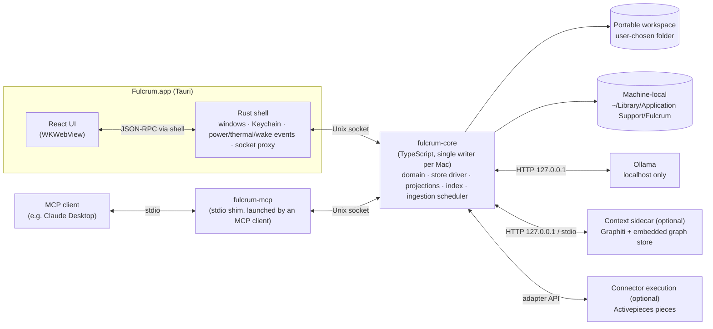
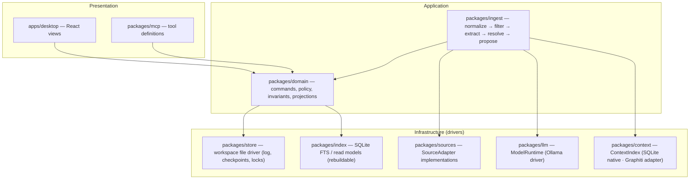
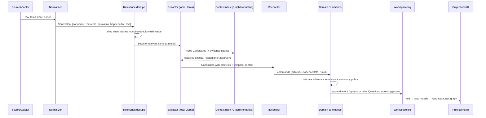

# Architecture

> **Status: proposed, not validated.** Nothing here has run on the target 2019 Intel MacBook Pro, and no connector, model or sync behavior has been tested end to end. Items marked *(provisional)* depend on a feasibility spike in [backlog/BACKLOG.md](../backlog/BACKLOG.md). Product behavior is defined by [PRODUCT_SPEC.md](PRODUCT_SPEC.md); this document only decides *how*.

## Goals, in priority order

1. **Clarity for one person.** Deterministic views over typed state. No hosted backend, no accounts, no embedded chat.
2. **Low maintenance.** Prefer a library to a service, and a file to a database server. Every heavy component (connector runtime, graph store, model) sits behind an interface and can be swapped or switched off without touching the domain.
3. **Local-first and private.** Inference on device by default. The portable workspace is plain files the user can see, back up and move.
4. **Runs on a circa-2019 Intel Mac** in a constrained mode; runs better on Apple Silicon. *(provisional — spike S2/S3)*

## Process model



- **One core process per Mac** owns all reads and writes of the workspace and the local index. It holds an exclusive lock (`Local/core.lock`). The UI and the MCP shim are both *clients* of the core; neither touches workspace files. This is how the UI and MCP are guaranteed to share one command layer, one validator and one audit log ([ADR-0009](decisions/0009-core-process-and-language.md)).
- Whoever needs the core first (the app window or an MCP client) starts it; it exits after an idle timeout unless it is the designated ingestion device and background ingestion is on.
- The UI is built browser-first against a transport interface, so it can be developed in a normal browser against a dev core; Tauri is the distribution shell ([ADR-0001](decisions/0001-desktop-shell.md)).
- Ollama, the context sidecar and the connector runtime are **optional peers**. If any is missing or paused, the app still opens, shows the last reconciled state and an honest freshness label ([OPERATIONS.md](OPERATIONS.md)).

## Layers and boundaries



Rules (enforced by lint import boundaries once the monorepo exists):

| Layer | May import | Must not |
|---|---|---|
| `apps/core` (composition root) | public `domain`, `mcp` and driver APIs, generated types, Node | domain/driver private modules |
| `apps/desktop`, `packages/mcp` | `domain` public API, generated types | `store`, `index`, any driver |
| `packages/domain` | generated schema types, `store` and `index` **interfaces** | Node/Tauri APIs, network, model calls |
| `packages/ingest` | `domain` commands, driver interfaces | write workspace files directly |
| drivers | Node APIs, their own third-party libs | `domain` internals |

The C6 implementation and development-only transport boundary are described in
[ADR-0014](decisions/0014-core-transports.md). The production core has no TCP
listener; its separate browser-development build is not a release artifact.

The **domain** is pure: given current state and a command, it returns either a rejection or a list of field-level ops plus derived questions. That makes every rule unit-testable with fixtures and keeps the AI path and the human path identical.

## End-to-end data flow



C7 binds the machine-local FTS5 read side through a typed interface; cache
failures do not revoke acknowledged events. See [ADR-0015](decisions/0015-local-search-cache.md).

Detailed stage contracts: [INGESTION.md](INGESTION.md). A source claim is never authoritative until the reconciler has turned it into a domain command that passed policy.

## Storage split

| Where | What | Synced? | Authoritative? |
|---|---|---|---|
| Workspace folder (user-chosen: local, Dropbox, Google Drive) | `workspace.json`, per-device append-only event logs, checkpoints | Optional, by the user's sync client | **Yes** — events are the record |
| `~/Library/Application Support/Fulcrum/` | device id, core lock, SQLite index, context store, connector cursors, MCP access log, backups | Never | No — rebuildable |
| macOS Keychain | connector tokens, MCP socket secret, optional workspace key | Never (unless the user's iCloud Keychain does so) | — |
| Ollama's model directory | Llama weights | Never; never in git | — |

Format, merge rules and migrations: [WORKSPACE_FORMAT.md](WORKSPACE_FORMAT.md) ([ADR-0005](decisions/0005-portable-workspace-event-log.md)).

## Module contracts (TypeScript, abridged)

These are the seams Codex implements against. Names are normative; signatures may gain options.

```ts
// packages/domain — the only write path
interface Domain {
  execute(cmd: CommandEnvelope): Promise<CommandResult>;          // see DOMAIN_COMMANDS.md
  query<Q extends QueryName>(q: Q, args: QueryArgs<Q>): Promise<QueryResult<Q>>;
  subscribe(listener: (change: AppliedChange) => void): Unsubscribe;
}

// packages/store — driver; knows files, not business rules
interface WorkspaceStore {
  open(dir: string): Promise<OpenedWorkspace>;                    // validates manifest, takes lock, reads device id
  append(events: ChangeEvent[]): Promise<void>;                    // fsync'd append to this device's segment
  readAll(): AsyncIterable<ChangeEvent>;                           // all devices, deduped, torn tails skipped
  writeCheckpoint(cp: WorkspaceStateDoc): Promise<void>;           // tmp file + rename
  latestUsableCheckpoint(): Promise<WorkspaceStateDoc | null>;
  watch(onExternalChange: () => void): Unsubscribe;               // FSEvents on other devices' logs
}

// packages/index — rebuildable read side
interface ReadIndex {
  rebuild(snapshot: WorkspaceStateDoc): Promise<void>;
  apply(change: AppliedChange): Promise<void>;
  search(text: string, scope?: SearchScope): Promise<SearchHit[]>;
}

// packages/sources
interface SourceAdapter {
  id: string;                                                      // 'gmail' | 'slack' | 'granola' | ...
  scopes(): Promise<SourceScope[]>;                                // accounts/channels/folders the user can opt into
  pull(scope: SourceScope, cursor: Cursor | null, limits: PullLimits): Promise<{ items: SourceItem[]; next: Cursor | null }>;
  permalink(item: SourceItemRef): string | null;
}

// packages/llm
interface ModelRuntime {
  status(): Promise<RuntimeStatus>;                                // installed? model pulled? busy? paused?
  extract<T>(prompt: ExtractionPrompt, schema: JsonSchema): Promise<Validated<T> | ExtractionFailure>;
  embed?(texts: string[]): Promise<number[][]>;
}

// packages/context
interface ContextIndex {
  ingest(episode: Episode): Promise<void>;                         // rebuildable from sources + assertions
  resolveEntities(mentions: Mention[]): Promise<EntityResolution[]>;
  related(target: Target, limit: number): Promise<RelatedContext>;
  rebuild(from: AsyncIterable<Episode>): Promise<void>;
}
```

## Technology selections

| Concern | Choice | Status | ADR |
|---|---|---|---|
| Desktop shell | Tauri 2 (WKWebView) | preferred; packaging on Intel *(provisional)* | [0001](decisions/0001-desktop-shell.md) |
| UI | React + TypeScript + Vite | decided | 0001 |
| Flow canvas | React Flow (`@xyflow/react`) + ELK.js layered layout | decided | 0001 |
| Timeline | vis-timeline, only if the Timeline view needs more than a simple SVG list | deferred | — |
| Core runtime | TypeScript on Node 22+ as a bundled sidecar | preferred *(packaging provisional — S7)* | [0009](decisions/0009-core-process-and-language.md) |
| Schemas | JSON Schema 2020-12 as source of truth; TS types generated; Ajv at runtime | decided | [0008](decisions/0008-schema-source-of-truth.md) |
| Local index | SQLite + FTS5 (machine-local only) | preferred | [0005](decisions/0005-portable-workspace-event-log.md) |
| Connectors | `SourceAdapter` backed by Activepieces pieces; execution mode to measure | direction accepted; execution provisional | [0011](decisions/0011-activepieces-integration-boundary.md) |
| Model providers | Runtime interfaces; local default, hardware-aware chooser; optional explicit hosted adapters | Selection/installation planned; model adoption pending | [0018](decisions/0018-model-choice-and-setup.md) |
| Temporal context | Native SQLite `ContextIndex` first; Graphiti adapter if S3 passes | *(provisional — S3)* | [0004](decisions/0004-context-layer.md) |
| Ingestion host | One designated device per workspace | decided | [0006](decisions/0006-single-ingestion-device.md) |
| MCP | Local stdio shim, off by default, scoped and logged | decided | [0007](decisions/0007-local-mcp-security.md) |
| License | MIT | decided | [0010](decisions/0010-license.md) |

## Related documents

- [DATA_MODEL.md](DATA_MODEL.md) — records, invariants, derived state
- [WORKSPACE_FORMAT.md](WORKSPACE_FORMAT.md) — files, events, merge, migration, backup
- [DOMAIN_COMMANDS.md](DOMAIN_COMMANDS.md) — command catalog, autonomy policy, undo
- [INGESTION.md](INGESTION.md) — connector → reconciliation pipeline
- [OPERATIONS.md](OPERATIONS.md) — local-default modes, sleep/wake, resources, model install
- [MCP.md](MCP.md) — tool contract
- [SECURITY_MODEL.md](SECURITY_MODEL.md) — threat model, trust, public repo boundary
- [ONBOARDING.md](ONBOARDING.md) — install and first run for non-technical users
- [RISKS.md](RISKS.md) — risk register
- [SCENARIOS.md](SCENARIOS.md) — golden scenarios and fixtures

Optional hosted adapters (ADR-0018) are infrastructure drivers behind the same
runtime boundary. Provider calls originate in the core after explicit local
configuration, never in the UI or domain. Keys remain in Keychain; selected data
and usage scope are enforced before a call. No app-hosted proxy is introduced.
