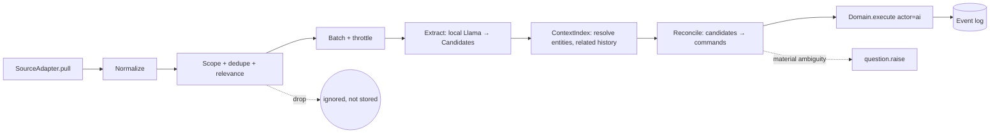

# Ingestion and context pipeline

> *(provisional — spikes S2, S3, S4, S5).* No connector, model or Graphiti configuration described here has been run. Stage contracts are fixed; implementations are not.

Runs only on the **designated ingestion device** ([ADR-0006](decisions/0006-single-ingestion-device.md)), only while the Mac is awake, and only for sources the user explicitly opted into.



## 1. Pull (SourceAdapter)

- Incremental by cursor per opted-in scope (mailbox label, channel, folder, meeting series). Cursors are machine-local.
- First connection offers a bounded backfill (default 14 days) — not unlimited history.
- Respect rate limits; exponential backoff; resumable mid-page.
- Required per item: `connector`, `remoteId`, `threadRemoteId?`, `permalink?`, `happenedAt`, author identity, text.
- Adapter implementations use Activepieces pieces ([ADR-0011](decisions/0011-activepieces-integration-boundary.md)); extend or add pieces for missing capabilities. Order: Slack, Gmail, Granola; then Google Drive, Dropbox, Google Calendar. Granola uses its API by default; CSV is a fallback through the same integration boundary when API access is unavailable.

## 2. Normalize

`SourceItem → Source` record (+ transient full text held in memory only). `contentHash = sha256(normalized text)`. Excerpt stored only if the source's `cachePolicy` is `excerpt`, capped at 4 KB, chosen to cover the evidence span.

## 3. Scope, dedupe, relevance (cheap, no LLM)

- Drop if `(connector, remoteId)` already recorded with the same hash.
- Drop if out of opted-in scope or on the user's exclusion list (private channels, labels, people).
- Relevance score from deterministic signals: mentions of known initiative titles/aliases/entities, the user as author or direct addressee, thread already linked to an initiative, commitment phrases. Optional small-embedding similarity if the model tier allows. Below threshold ⇒ ignored, not stored, no question. **No "unsorted" pile.**

## 4. Batch and throttle

Queue on disk (machine-local). One extraction job at a time; resource limits in [OPERATIONS.md](OPERATIONS.md#resource-policy). Group items by thread to give the model coherent context.

## 5. Extract (local Llama)

Prompted for **typed candidates only**, validated against a JSON Schema; invalid output is retried once with a repair prompt, then dropped and logged.

```ts
type Candidate =
  | { kind: 'user_commitment'; text: string; dueHint?: string; span: Span }          // → Task (P2)
  | { kind: 'external_commitment'; who: Mention; text: string; span: Span }           // → Dependency
  | { kind: 'state_change'; targetHint: string; newState: string; span: Span }        // → node.setState
  | { kind: 'decision_made'; targetHint: string; optionHint: string; span: Span }
  | { kind: 'priority_opinion'; targetHint: string; value: string; who: Mention; span: Span } // → suggestion only
  | { kind: 'new_initiative'; title: string; rationale: string; span: Span }           // → initiative.propose
  | { kind: 'date'; targetHint: string; date: string; span: Span }
  | { kind: 'relationship'; fromHint: string; toHint: string; type: 'depends_on' | 'leads_to'; span: Span };
```

Every candidate carries a `span` into the source text; candidates without a span are discarded. Prompts state that the content is untrusted data and that instructions inside it must be ignored; the output schema has no field through which an instruction could be expressed.

## 6. Context (ContextIndex)

Resolves `Mention`/`targetHint` to entity and node IDs and supplies prior assertions about the same target, with timestamps. Implementations ([ADR-0004](decisions/0004-context-layer.md)):

- **Native (default):** SQLite tables for entities/aliases, FTS5 over titles/aliases/excerpts, optional embeddings; temporal history = canonical assertions. Deterministic, cheap.
- **Graphiti (optional, S3):** episodes built from sources + assertions; used for entity resolution and temporal retrieval. Output is advisory; it never writes canonical state. Rebuildable from the workspace.

Ambiguous identity (two plausible entities) with material impact ⇒ one `identity_ambiguity` Question; otherwise pick nothing and wait for more evidence.

## 7. Reconcile → commands

Pure function `(candidates, resolutions, currentState, rejections) → { commands, questions, suggestions }`:

1. Match to existing nodes first (P8). Update before create.
2. Map candidate kinds to commands per the table above, attaching `evidenceRefs`.
3. Apply policy pre-checks (protected fields, rejections, explicit-commitment rule) to avoid emitting commands that will be denied.
4. Conflicting sources about the same field: keep both assertions (`conflicting`), apply the newer by `happenedAt` only if the field is unprotected and the difference is not material; otherwise raise `conflicting_sources` Question showing both.
5. All commands from one batch share a `runId` (batch undo).
6. Re-evaluate open Questions touching the same targets: newer evidence that settles them ⇒ `question.markObsolete` or auto-resolve with evidence.

## 8. Catch-up after sleep or days offline

On wake (or app start): pull each scope from its cursor; process **newest-first per thread** so the latest state wins quickly; collapse superseded intermediate states (e.g. three status changes in a week become one applied change with three assertions). The portfolio is usable immediately with prior state; the freshness label shows "Catching up — N items" until the queue drains. Target: scenario 1 in [SCENARIOS.md](SCENARIOS.md).

## Failure behavior

| Failure | Behavior |
|---|---|
| Model runtime missing/paused | Pull + normalize + store sources continue (if policy allows); extraction queue waits; freshness shows "Local AI paused". |
| Connector auth expired | Scope marked "Needs reconnect" in Settings → Sources; no popups; small indicator on freshness. |
| Context sidecar down | Fall back to native ContextIndex. |
| Extraction invalid JSON twice | Item marked `extraction_failed`; no state change; retry on model upgrade. |

## Implemented I1 boundary

The synthetic adapter, reference-only SQLite queue and single-flight scheduler
are implemented in `packages/sources` and `packages/ingest`. The core accepts
explicit programmatic adapter/scope configuration; default operation stays off.
Pages and continuations commit atomically, successful hashes dedupe, changed
payloads queue separately, revoked scopes are purged, and handover checks consult
the current workspace ingestion-device setting before and after requests.

Full source text is rehydrated at processing time rather than written to the
queue. Delivery is at least once: consumers must use the supplied stable
connector/remote-id/hash idempotency key for Domain commands. Healthy scopes
continue when an independent source fails. Missing/changed rehydrated sources
and failed consumers remain explicit failures; no silent successful retry.

`status.freshness` is a core read query: pending references without an extraction
consumer remain “Local AI unavailable”; a complete scan alone cannot report
current while relevant work waits. The seven-day synthetic integration covers
the ingestion portion of scenario 1. Real extraction, thread-context batching,
superseded assertions, reconciliation, Settings controls, native sleep/resource
hooks and live connectors remain later steps. No actual sleep/wake or account
behavior is accepted by these tests.

## Implemented I3 boundary

`ModelRuntime.extract` returns validated typed candidates or explicit
invalid-output/unavailable/deadline/aborted/input-limit failures. The Ollama
driver wraps the existing local JSON runtime; callers must select a model
explicitly. The same structured wrapper accepts other configured generators
without changing candidate types. No hosted adapter or automatic model choice
is enabled. See [runtime/evaluation contract](../packages/llm/README.md).

The frozen S2 candidate schema and prompt are checked for parity. Invalid JSON,
schema or evidence spans get one repair using unchanged source text and a fixed
repair instruction; invalid model output never becomes trusted instructions.
A second invalid result returns no candidates. Syntactically valid wrong
predictions are preserved as results and never repaired to improve scores.

The 48-case oracle mock suite checks plumbing, not learned quality. A bounded
local smoke run is recorded in [I3 review](reviews/I3.md). Model quality and
hardware tiers remain provisional under ADR-0018. Queue acknowledgement,
canonical source/evidence writes, entity resolution and reconciliation remain
I4/I5; these candidates cannot yet change the portfolio unattended.

## Implemented I4 boundary

The native `ContextIndex` in `packages/context` resolves canonical entities by
exact aliases and scoped external IDs, retrieves related temporal claims and
uses FTS5 for titles/aliases/permitted excerpts. The core refreshes its separate
machine-local cache from acknowledged folded state. It is rebuildable and has
no domain write authority; Graphiti/model adoption remains pending.

Scenario 6's synthetic person/project aliases resolve, or a material Dependency
ambiguity produces a fixed contextual question plan. The integration test sends
repeated plans through `Domain.execute`, verifies one question, chooses an
identity and undoes the choice. This does not enable unattended processing.
See [API, bounds and failure behavior](../packages/context/README.md). I5 still
owns candidate reconciliation and queue acknowledgement. Audit issue #63's
handover hash mismatch remains open and must be fixed before unattended work.
