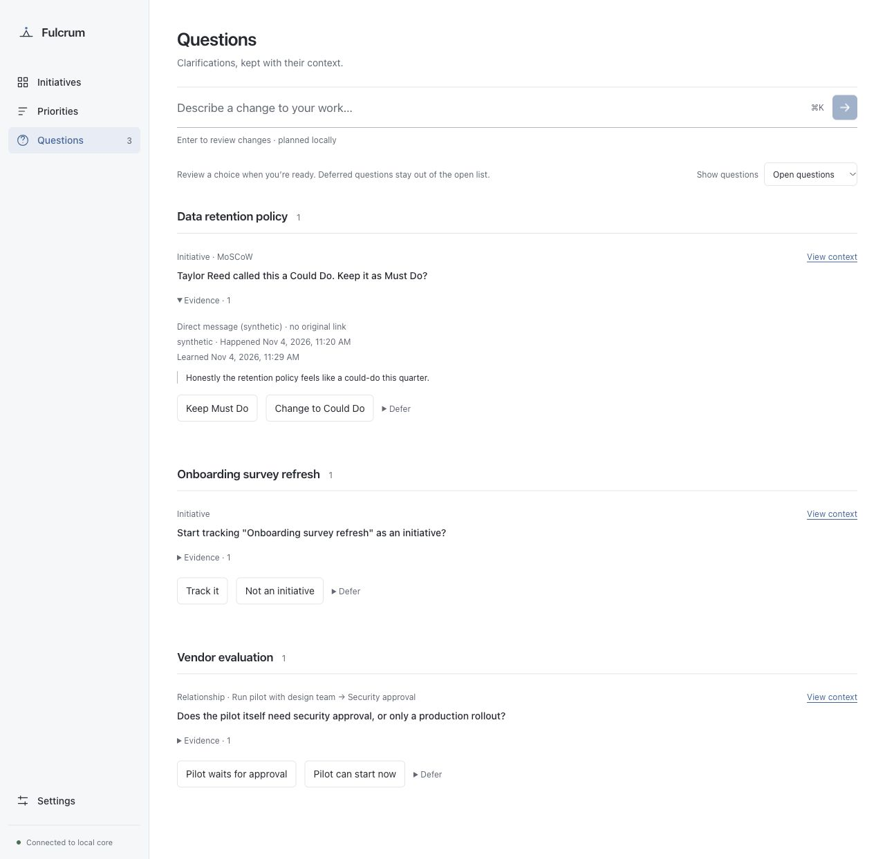
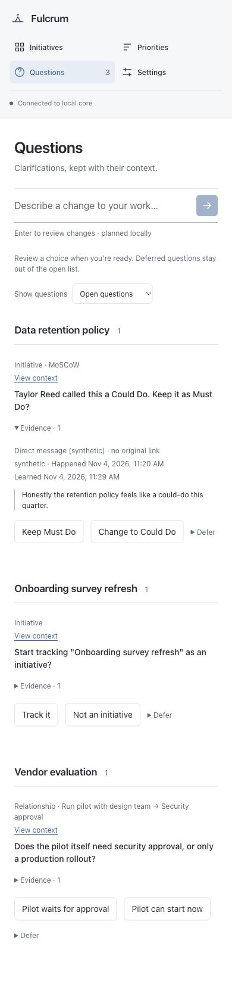
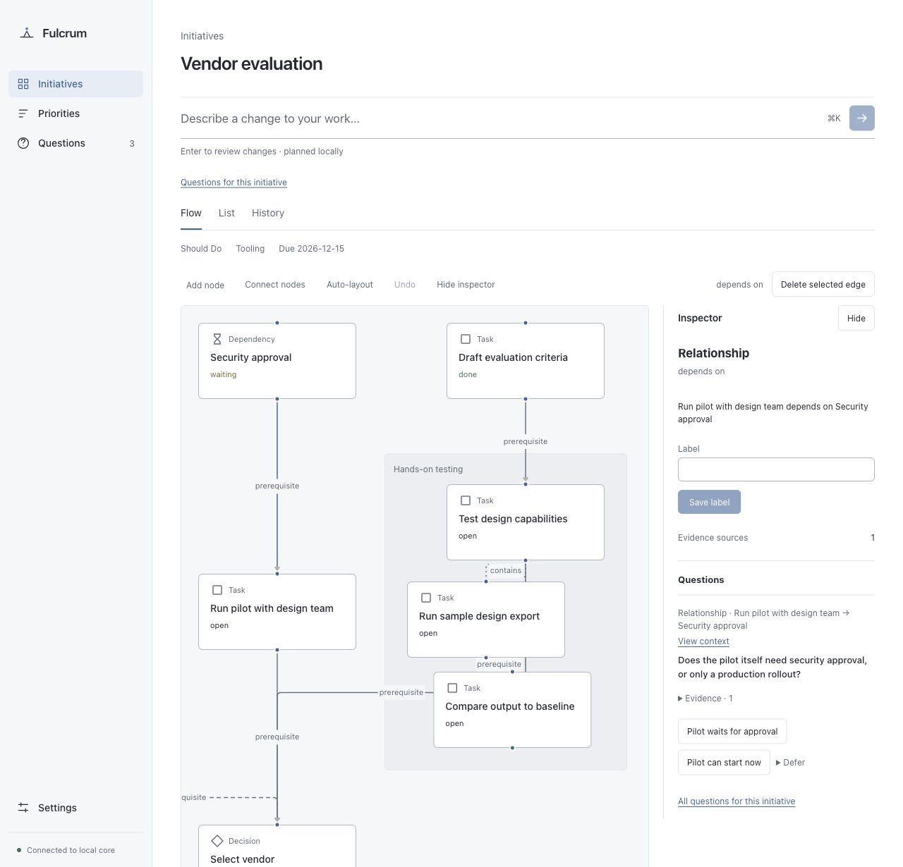

# U8 — Questions Center review

## Scope and direction

Extend the existing Questions destination and contextual inspector in Operate
mode. Product behavior follows PRODUCT_SPEC.md, DESIGN_RULES.md and ADR-0019.
No new visual identity or alternative layout was requested.

- Thesis: a question is a contextual choice, grouped with its initiative.
- Own world: existing neutral surfaces, system type, muted blue links, thin rules,
  flat lists and inline disclosures; preserve the sidebar and command bar.
- Story: find an initiative, inspect its evidence, choose an action or defer;
  revisit deferred/answered questions and undo an acknowledged change.
- First viewport: existing page heading and command entry, one state filter,
  initiative headings and question rows with context, evidence and actions.
- Form: extend the existing list/inspector composition. No concept seed or new
  comp applies to this specified extension. Node/relationship links select the
  exact object in the existing flow; browser back keeps its usual meaning.

## Verification

Synthetic fixture only. `pnpm check` passed on Node 22: 478 workspace tests and
79 reference tests, with one existing reference TODO. The new checks cover scoped
reads, original-link safety/cache policy, late responses, pending-action guards,
failed writes, dated/indefinite deferral, keyboard feedback and exact context
navigation. Four existing card snapshots changed only their scoped link targets.

Browser checks used a disposable file-backed core: answer/count acknowledgement,
relationship inspector navigation, Tomorrow deferral, undo and initiative scoping.
1280px and 390px captures show the same list and expanded evidence. At 390px the
body and viewport both measured 390px with no overflowing main-content element.
The review server used an isolated temporary port because another preview owned
5173; repository launch settings were unchanged. Actual native launch and owner
usability remain unverified.

The finish review accepted the flat layout and responsive adaptation, requesting
only correction of stale design documentation. That documentation now describes
U8. The mechanical detector's new heading-size advisory was corrected by reusing
the existing 14px body size; preexisting 16px command-input drift was left alone.





## Owner review

1. Install Node 22 LTS and pnpm 10.11.0. From the repository root, make a separate
   checkout of merged main so any running benchmark checkout stays untouched:

   ```sh
   git fetch origin
   git worktree add ../fulcrum-u8-review origin/main
   cd ../fulcrum-u8-review
   corepack enable
   pnpm install --frozen-lockfile
   pnpm check
   pnpm dev
   ```

2. Open `http://127.0.0.1:5173/#questions`. Use this disposable synthetic workspace.
   Inspect the initiative groups, expand Evidence, and follow View context for
   the Vendor evaluation relationship. Check the selected inspector and use Back.
3. Answer a question, check the count/list, then Undo. Defer another question
   until Tomorrow or Until I return, switch Show questions to Deferred and answer
   it there. Review Answered and No longer needed states. Confirm no popups occur.
4. From a portfolio card's question count, verify the initiative-scoped list and
   All questions return link. Inspect a node or edge to review its attached
   questions. Try Tab, Shift-Tab, Enter, visible focus and a narrow window.
5. Record observations or blockers below, then tick the Owner box for step 29 in
   backlog/PROGRESS.md. Do not tick other pending checks.

## Owner observations

Pending.
