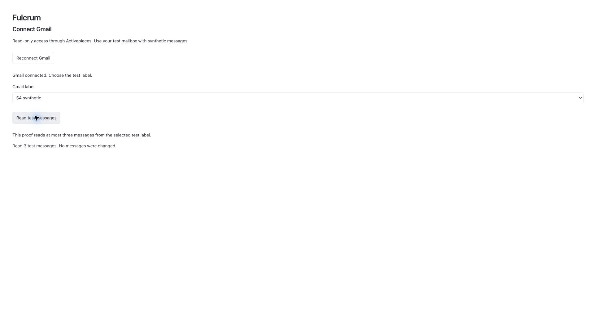

# S4: Hosted OAuth with a local Activepieces runtime

Experiment started November 21, 2026. See [ADR-0029](../../decisions/0029-managed-connector-oauth-spike.md).
This is a separate test from the existing direct-piece Gmail implementation.

## Question

Can another app manage Gmail sign-in and retrieval without requiring a
Fulcrum-owned or user-created Google OAuth client, while connector execution
stays local and Gmail access remains read-only?

## Verified so far

- The live `https://secrets.activepieces.com/apps?edition=ce` catalog returned
  Gmail and Slack entries. The public catalog is not proof of working consent
  or distribution permission.
- Activepieces 0.93.0 source at commit
  `dec8e16d4e02ee1fe9a5cdfb1a30c7a03785401b` offers a Permissions selector
  when a piece declares multiple OAuth scopes. Its authorization endpoint
  accepts a nonempty subset of the piece's declared scopes.
- The same source sends authorization-code claims and refresh requests to
  `secrets.activepieces.com`; it does not route email-body reads through that
  service in those methods. This is source inspection, not a traffic audit.
- A separate Lima 2.3.0 VM booted on Intel macOS with two CPUs, 4 GiB RAM,
  20 GiB sparse disk and no shared host folders. Docker reports 29.10.0.
- The previously reviewed 0.93.0 image was pulled successfully at digest
  `sha256:6ed79f941fd41a8ab03ca659581191210a66512de52f7d623817f88deb715db7`.
  Its local container started with PGLite, an in-memory queue, one worker,
  hosted OAuth enabled and telemetry disabled. No model is part of this test.
- The local UI and flags endpoints returned HTTP 200. Flags reported version
  0.93.0, edition `ce`, and `CLOUD_AUTH_ENABLED: true`. The browser displayed
  local account creation rather than asking for a Google client ID/secret.
- One startup `docker stats` sample reported 1.666 GiB container memory and
  123.47% CPU. This is not an idle measurement and excludes the VM overhead.
- The owner completed local account setup. In the live browser UI, the default
  Gmail connection offered Permissions without asking for a client ID or
  secret. Deselecting send, compose and modify left `gmail.readonly` and
  `email`. Connect opened Google's account chooser for Activepieces with
  exactly those scopes and `https://secrets.activepieces.com/redirect` as
  redirect. The owner subsequently completed consent with the test mailbox.
- The local Connections UI displayed the Gmail connection as Active. A live
  label dropdown returned the synthetic label. A draft Manual Trigger → Gmail
  Find Email flow (piece 0.19.0), filtered to `S4 synthetic` with Max Results
  set to 3, returned Tested Successfully, Found Yes and Count 3. Success was
  observed within 9 seconds of clicking Test Step, including browser/tool
  overhead. This is not an isolated API latency or model-throughput benchmark.
  The flow was not published and no inference or mail mutation was run.
- After restarting the container, reloading the browser restored the connection,
  draft flow, label and three-message limit. Retest Step performed another read
  and again returned Count 3, with success visible within 7 seconds. No new
  Google sign-in was required. This verifies restart persistence with the
  existing credential, not refresh after token expiry.
- A single post-test resource sample reported 1.766 GiB container memory and
  22.87% CPU. It excludes VM overhead and is not a settled idle benchmark.

## Evidence links

- [Hosted OAuth configuration](https://www.activepieces.com/docs/install/reference/environment-variables)
- [OAuth service source](https://github.com/activepieces/activepieces/blob/dec8e16d4e02ee1fe9a5cdfb1a30c7a03785401b/packages/server/api/src/app/app-connection/app-connection-service/oauth2/services/cloud-oauth2-service.ts)
- [Permission selector](https://github.com/activepieces/activepieces/blob/dec8e16d4e02ee1fe9a5cdfb1a30c7a03785401b/packages/web/src/app/connections/oauth2-connection-settings.tsx)

## Live checks

Successful: owner-completed shared-app consent, active local connection, label
retrieval, a three-message synthetic read and a fresh read after container
restart. The requested scopes were
`gmail.readonly` and `email`; token contents and a token-reported grant were
not inspected or exported.

Pending: credential refresh after expiry, incremental catch-up,
settled memory, and separate retrieval/extraction timing. No model-processing
speed improvement or production readiness is claimed.

Use only a throwaway mailbox containing synthetic messages. Keep accounts,
tokens, execution payloads and local runtime data out of the repository.
The stock piece declares send/compose/modify scopes too; deselect them before
opening consent. Stop if the actual grant requires write access.

### Resume this local test

1. Open `http://localhost:18080` on the test Mac. Create a local admin with
   `s4-reader@example.invalid` and a new password entered by the owner; leave
   newsletters unchecked. This is an account in the disposable local runtime,
   not an Activepieces Cloud signup. Never paste the password in chat.
2. Open Connections and add Gmail using the default OAuth method, not Custom
   OAuth2 App or Service Account. Expand Permissions and retain
   `https://www.googleapis.com/auth/gmail.readonly` and `email`; deselect send,
   compose and modify. Inspect the generated authorization request and the
   actual Google consent screen before granting anything.
3. The owner signs in with the synthetic-only Google test account and approves
   the displayed read-only access. Stop if Google blocks the shared app,
   requires a custom client, or requests mail mutation permissions.
4. Run only a manually triggered bounded read flow against the synthetic label.
   Verify a small page's counts, restart persistence, another bounded page,
   refresh and incremental catch-up separately. Do not enable send/draft/label
   actions, public webhooks, full mailbox backfill or model processing.
5. Record counts, permission names, durations and failures here. Do not copy
   account identifiers, credentials, message bodies, execution payloads or
   authenticated screenshots into the repository.

The loopback service is a temporary experiment, not installed into Fulcrum.
The owner completed local account creation and resumed browser automation.
The owner completed test-account consent and bounded reads succeeded before
and after container restart. The local draft remains unpublished. At the
first handoff Chrome automation was blocked by another extension's open UI;
the service remained reachable.

## Recommendation

The shared-app/local-runtime arrangement is viable for a bounded Gmail read:
Fulcrum needed no Google OAuth registration, and mail was retrieved by the
local Activepieces runtime. This corrects the assumption that hosted OAuth
necessarily requires cloud execution of mail reads. Credential exchange and
refresh still depend on Activepieces' hosted service.

Continue with a narrow local `SourceAdapter` bridge experiment before adopting
this for production. Stock Find Email returns a bounded list, not Fulcrum's
durable incremental ingestion contract. Pagination, expired-history recovery,
dedupe, source rehydration, output retention and shared-app distribution terms
still need decisions and tests. This does not resolve slow local extraction.
Keep existing owner acceptance boxes and production decisions unchanged.

## Dashboard-free connection proof

On November 21, the owner requested a live proof that the Activepieces
dashboard need not appear. The isolated
[implementation and procedure](../../../spikes/s4/managed-oauth/README.md)
serve a Fulcrum React screen at `http://localhost:18081`. A fresh Community
Edition instance with a separate empty data volume listens on loopback port
18082. Earlier test containers/volumes are preserved and stopped.

The following sequence succeeded without opening that instance's dashboard:

1. The local server provisions a synthetic owner/project through the ordinary
   first-user signup API with telemetry/newsletters disabled. Its random local
   credentials/session remain in process memory, never sent to the browser.
2. Connect Gmail asks the local authorization endpoint for only `gmail.readonly`
   and `email`, using Activepieces' shared app. Only the Google popup appears.
3. Google recognizes the test mailbox's existing read-only grant. Its details
   show mail read access and account identity, with no mail mutation access.
4. The hosted redirect sends the result to the Fulcrum popup opener. The proof
   checks the redirect origin and popup identity, then consumes a single-use,
   expiring local attempt to create the connection through the API.
5. The local piece-options API returns labels; the screen offers only
   `S4 synthetic`. Selecting it and Read test messages creates a fixed,
   unpublished Find Email action limited to three messages.
6. The proof tests that action, polls its run and validates all three messages
   contain text/HTML rather than per-message error records. The screen reports
   `Read 3 test messages. No messages were changed.` Only counts reach the UI.

Two findings shaped the implementation:

- A second signup on an instance that already has an owner returns
  `INVITATION_ONLY_SIGN_UP`. The clean-instance proof respects that restriction;
  it does not enable public signup or bypass authentication. Production needs
  an app-managed first-run identity and durable credential custody.
- The builder saves test outputs into sample data through frontend operations.
  A completed test run does not by itself populate the sample-data endpoint.
  A failing regression reproduced this; the corrected proof reads the
  completed run's output instead. Large offloaded outputs fail closed here.

Validation: seven offline protocol/server tests pass, including callback
origin/window binding, replay rejection, label/read limits, per-message error
rejection and exact-origin JSON mutations. Strict proof/UI/workspace
typechecks and lint pass. `npm run check:ui` passes all 58 stories with no
accessibility violations and builds the workshop. The reference suite passes
under supported Node 22.23.5: 116 pass, one existing skip, one existing TODO.
The initial host Node 23 run failed existing S2/S7 checks; Node 23 is outside
the repository's supported engine range.

This proves the dashboard-free browser connection and bounded read path using
Community Edition APIs, without the Enterprise embedding SDK. It does not
prove a packaged Tauri system-browser callback, runtime installation/lifecycle,
server-process restart with persistent local identity, token refresh after
expiry, incremental ingestion, output retention or vendor approval for
redistribution. The prototype is not enabled in the production app.
